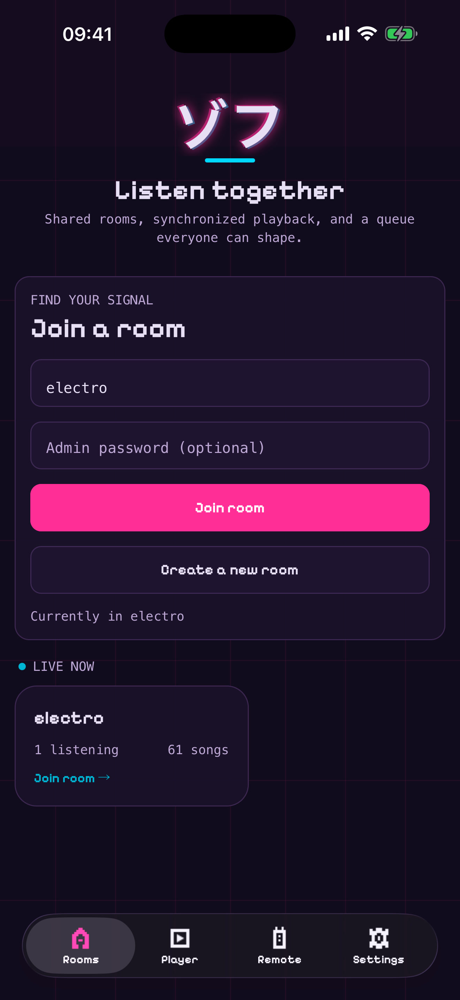
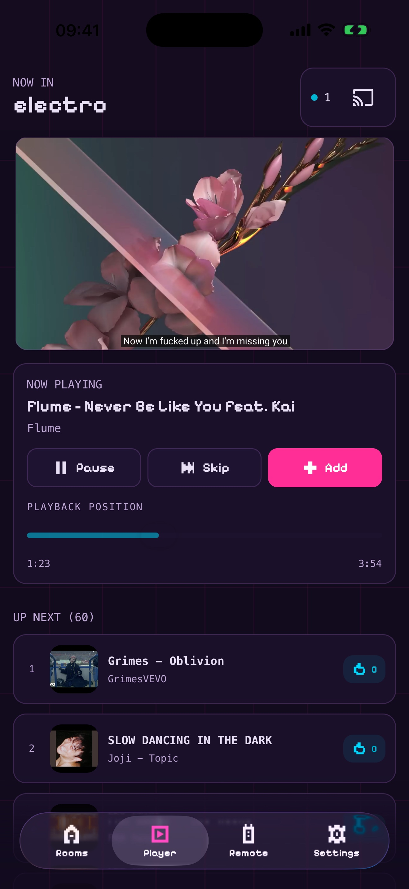
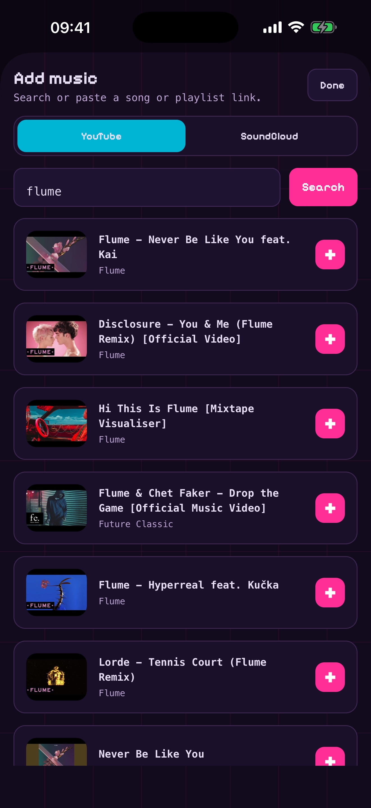

# Zoff Mobile

Native Expo app for Zoff rooms and remotes. It uses the same typed `@vibes/api`,
`@vibes/models`, and shared safety utilities as the web apps, while rendering
native iOS and Android controls. The queue uses React Native's virtualized
`FlatList` with a bounded render window, so a large room does not mount every
song at once.

Native colors and spacing mirror the values in `packages/tailwind/theme.css`.
NativeWind compiles the shared Tailwind 4 theme into React Native styles; no
DOM-oriented UI components are shipped in the native bundle.
Shared controls and the native YouTube wrapper come from `@vibes/ui/native`,
while platform-neutral presentation helpers come from `@vibes/ui/shared`.
The app deliberately has no Expo web target.

The landing-page AI toggle powers up a pink/cyan moving input border and a
bounded set of varied pixel stars and notes above the field. Native Reanimated
worklets drive each frame; particles fade before leaving the field area.
Motion stops when backgrounded or leaving the screen and respects reduced
motion. The toggle retains its sparkle icon and the active label is
“What’s the vibe?”.
The ignition sweep and layered pink/cyan halo animate only overlays, not layout.
The heading, description, label slot and helper stay mounted in both modes so
switching AI on or off does not move the form or room list.

On iPhone, the bottom navigation pill and a separate circular add action share
one row, using native Liquid Glass on supported iOS versions and an opaque
fallback elsewhere. Expo Router still owns the tabs and add sheet. The floating add
action above navigation is tablet-only. App buttons and native tab presses provide short
selection haptics without waiting for the haptic engine before acting.
iOS page sheets omit the full-screen top inset while retaining bottom padding.
Pull-to-refresh holds landing content in place and animates only the logo;
Browse all aligns the room browser to the top. The background grid uses bounded
2D perspective geometry and pauses when inactive or reduced motion is enabled.

## Navigation and requests

Expo Router owns screen navigation, deep links, system tabs, modal presentation,
and route error boundaries. Mobile has no second router or route registry.
The only route tree is `src/app`. Screens and layout controls live under
`src/components`, workflows in `src/hooks`, and named typed API functions in
`src/requests`. There are no native loader/action route modules.

App hooks call typed request handlers through `@vibes/api`. The small shared
request hook handles pending state and abort cleanup; it does not match paths,
cache routes, or implement navigation. Initial preferences, profile, discovery,
and remote-session data are loaded by the app provider. Mutations update their
own state or explicitly refresh the affected room.

## Visual preview

<p>
  
  
  
</p>

## Included flows

- Music and Watch entry points with separate public-room browsing and generation
  prompts. Watch rooms support YouTube videos; Music rooms support the enabled
  YouTube and SoundCloud sources. Room type is fixed when the room is created.
- Join, create, and change rooms, including protected rooms and currently active
  public rooms.
- Play, pause, host seek, skip, vote, search, and add playlist items or provider
  playlists from pasted links.
- Official embedded players for enabled YouTube and SoundCloud
  tracks. YouTube uses `react-native-youtube-iframe`, which wraps the official
  IFrame Player API and exposes player state, error, and seek controls to the
  native app.
- Google Cast discovery and the Zoff custom receiver handshake.
- Pair a remote by QR code or one-time code and control the paired machine.
- Authenticate as a room admin and update room mode, queue behavior, public
  visibility, and enabled providers from native room-settings sheets.
- Expo Router tabs: iPhone uses a glass navigation pill with a separate add
  action; iPad retains system tabs. Android uses a standard tab navigator with the floating phone
  menu or tablet navigation. Search,
  creation, and other transient tasks use native page-sheet/modal presentation
  instead of web-style popovers.
- Automatic light/dark appearance based on the device setting.

## Requirements

- Node.js 18 or newer and the repository's pinned pnpm version.
- Xcode, CocoaPods 1.15.2 or newer, and an iOS simulator; or Android Studio
  with an Android emulator.
- A physical device is recommended for Cast and QR testing.
- The phone and Cast device must be on the same Wi-Fi network.

Google Cast is a native module and is not available in Expo Go. Use a development
build for meaningful testing.

## Install

From the repository root:

```sh
pnpm install
pnpm --filter @vibes/mobile typecheck
pnpm --filter @vibes/mobile lint
```

The app uses `https://zoff.me` by default. To use a local backend, expose the Go
API on an address reachable by the simulator or phone and set:

```sh
EXPO_PUBLIC_API_URL=http://192.168.1.20:8080 pnpm --filter @vibes/mobile start
```

Do not use `localhost` for a physical phone; it refers to the phone itself.

## Run a development build

Generate native projects and launch locally:

```sh
pnpm --filter @vibes/mobile exec expo prebuild --clean
pnpm --filter @vibes/mobile exec expo run:ios
# or
pnpm --filter @vibes/mobile exec expo run:android
```

Native-project changes belong in an Expo config plugin under `plugins/`; do not
commit generated `ios` or `android` directories or a root-level `app.json`.

SDK 57 opts into the iOS scene lifecycle through `expo-build-properties`
(`ios.enableSceneSupport`). This is required for Xcode 27 builds to launch on
iOS 27. Prebuild configures Expo's scene delegate to create the window and start
React Native, while preserving lifecycle and link delivery. Keep this enabled
until upgrading to an Expo SDK that adopts scenes by default.

After the first native build, start Metro with:

```sh
pnpm --filter @vibes/mobile start -- --dev-client
```

Test at least these flows before publishing:

1. Join a room and confirm its provider list, current song, and queue load.
2. Search each enabled provider, add a result, vote, pause/play, seek, and skip.
3. Queue several hundred fixture rows and confirm scrolling stays smooth and
   memory remains stable.
4. Pair a web machine using both QR and one-time-code paths; change playback and
   confirm the machine follows without counting the remote as a listener.
5. Connect to a Cast device and confirm the receiver joins the selected room.
6. Test light and dark device appearances on both iOS and Android.
7. Switch Music/Watch, browse and generate in each, and verify Watch only offers
   YouTube. Confirm Watch rooms use video and watcher labels throughout the app.

## EAS development and preview builds

Native tab screens own their safe-area padding and scroll-content spacing.
Keep `disableAutomaticContentInsets` on their native tab triggers and
`contentInsetAdjustmentBehavior="never"` on their scroll views, so iOS does not
apply a second inset adjustment after presenting a tab. The root safe-area
provider starts with `initialWindowMetrics` before font/startup loading. Full-screen
pages use its window insets rather than transient per-tab measurements. Screens and sheets use
`ScreenSafeArea`, which applies the context insets in the first React render,
rather than waiting for a native safe-area view to attach and update its padding.
Sheets continue using their local insets. Scroll views also explicitly disable
automatic content and indicator inset adjustment. Do not hide
layout corrections behind delayed rendering or entrance animations. Queue
reordering still animates, but initial queue/search rows render in place.

Install and authenticate the EAS CLI, then associate the project with the Zoff
Expo organization on the first run:

```sh
pnpm dlx eas-cli login
pnpm dlx eas-cli init
pnpm dlx eas-cli build --profile development --platform ios
pnpm dlx eas-cli build --profile development --platform android
```

Internal release-candidate builds use the `preview` profile:

```sh
pnpm dlx eas-cli build --profile preview --platform all
```

## Initialize Expo and App Store Connect

The Expo project and Apple credentials must be created by an authenticated
project owner. None of these credentials belong in this public repository.

From `apps/mobile`:

```sh
pnpm dlx eas-cli login
pnpm dlx eas-cli init
pnpm dlx eas-cli credentials --platform ios
```

During credential setup, configure an App Store Connect API key for EAS Submit.
Store the key in EAS credentials, not in Git, `.env`, `app.json`, `eas.json`, or
the workflow file. Once the App Store Connect app record exists, add its public
Apple ID as `submit.production.ios.ascAppId` in `eas.json`.

Link the GitHub repository from the Expo project dashboard before enabling the
tag-triggered workflow.

## Automated TestFlight releases

`apps/mobile/.eas/workflows/testflight.yml` builds an iOS production binary and
uploads it to TestFlight when a matching release tag is pushed:

```sh
git tag mobile-v0.2.0
git push origin mobile-v0.2.0
```

Do not push a matching tag until Apple credentials, the App Store Connect app
record, TestFlight information, and internal tester groups have been verified.
The workflow uploads to TestFlight only. It does not submit a version for public
App Store review.

For a dry run that creates no build and performs no submission, validate the
workflow after logging in:

```sh
pnpm dlx eas-cli workflow:validate .eas/workflows/testflight.yml
```

## Publish to Apple and Google

Before the first store build:

1. Confirm ownership of the bundle/package ID `me.zoff.mobile` in Apple
   Developer and Google Play Console.
2. Run `eas init` and commit the generated Expo project ID if it is not already
   present. Do not copy a project ID from another app.
3. Configure signing credentials through EAS, privacy declarations, store
   screenshots, support URL, and the Zoff privacy-policy URL.
4. Verify the registered Cast receiver `1FAF5D9F` remains published and that its
   sender configuration permits the production iOS and Android apps.
5. Complete provider-policy review. YouTube and SoundCloud playback is
   intentionally rendered through their official controls; do not replace it
   with extracted media URLs.
6. Review the copy-ready App Store packet in `docs/app-store/`, including its
   screenshots, metadata, privacy answers, age rating, review notes, and final
   release checklist.

Create and submit production builds:

```sh
pnpm dlx eas-cli build --profile production --platform all
pnpm dlx eas-cli build --profile production --platform ios --local
pnpm dlx eas-cli submit --profile production --platform ios
pnpm dlx eas-cli submit --profile production --platform android
```

Store submission is intentionally not automated from CI until the Apple team,
Google Play service account, and final store metadata are configured by the app
owner.
