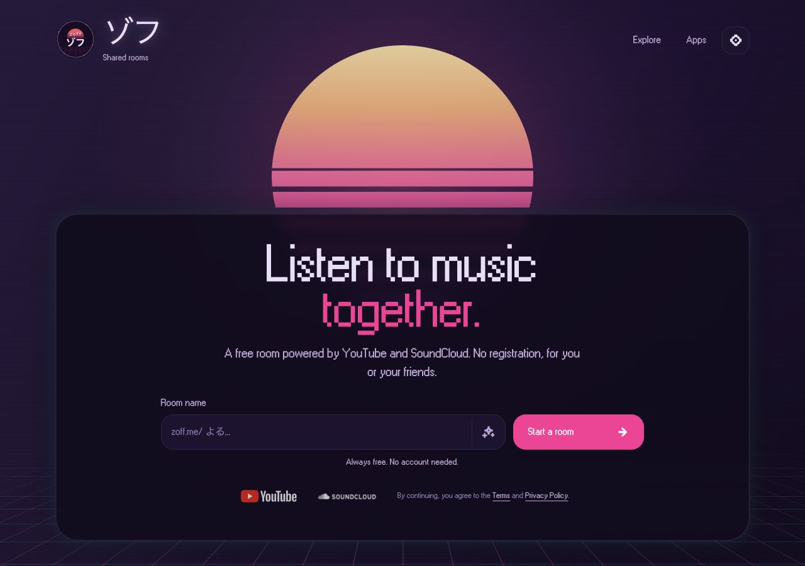
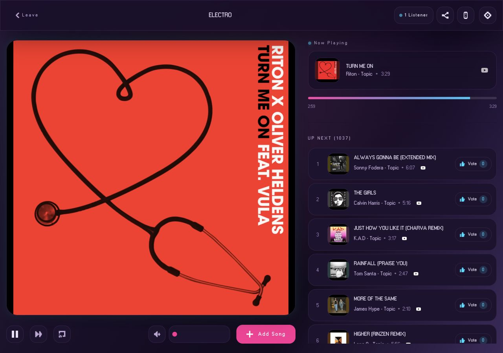
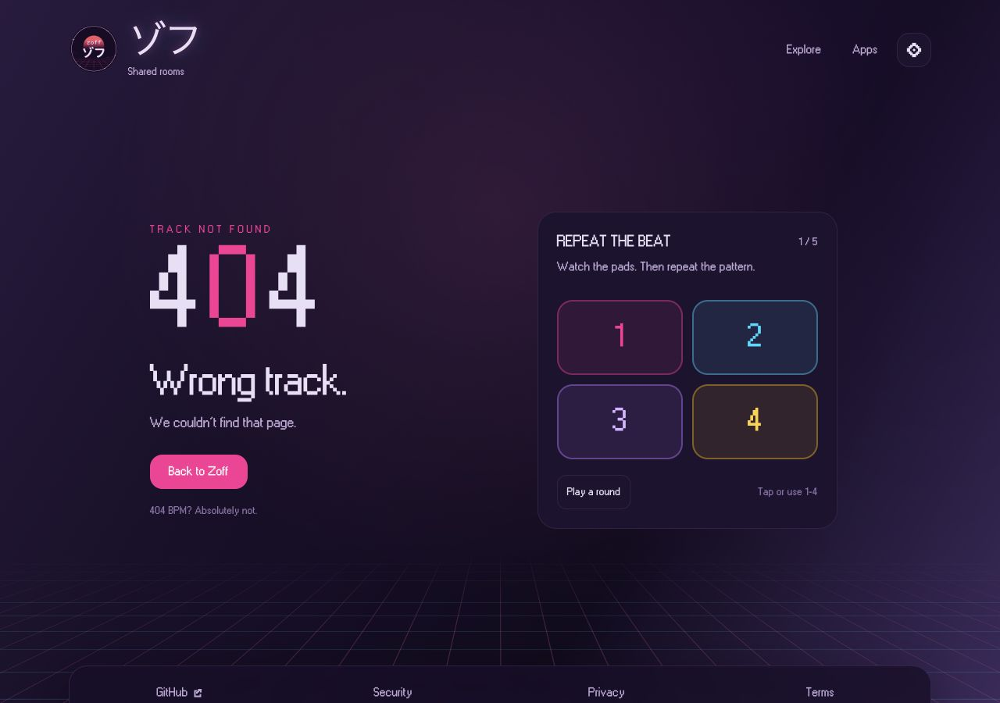

# Vibes Platform

The primary web application for the Vibes ecosystem. It serves as the main interface for users to create rooms, manage queues, and control synchronized playback across devices with full server-side rendering support.

## Web installation and native apps

The web manifest supports standalone installation with ordinary and maskable
192px/512px icons. Its stable `id`, `start_url` and scope remain `/`, preserving
the identity of existing web installs. On macOS Sonoma or later, Safari's
File > Add to Dock installs the site as a web app; Chromium browsers can offer
their web-app install controls when their engagement requirements are met.

Keep `prefer_related_applications` false so the native-app listings do not
suppress web installation. Both the App Store and Google Play listings remain
in the manifest, and the iOS Smart App Banner and visible store links remain
available. This does not change native app IDs, deep links or store releases.
Playback and room synchronization require a network connection; installation
does not promise offline playback. Do not cache live room/session responses in
a service worker just to enable installation.

## Embed sharing

The room's **Embed player** settings include an **Autoplay** toggle, off by
default. Enabling it adds `autoplay=true` to the embed URL, keeps the iframe's
`allow="autoplay; encrypted-media"` permission, and uses eager loading so the
player can start when the host page loads. Disabling the player also disables
autoplay in the generated code. Existing embeds remain click-to-play.

Autoplay requests sound, not muted playback. Browsers and host-page permissions
can still require a click; keep that limitation visible beside the toggle.

## Room playback

Device settings include **Persistent player**, off by default and saved only
on the current device. When enabled, leaving a room within Platform minimizes
its existing player into a bottom-right frame. The room name and video reopen
the room; Play/Pause, Skip and volume remain usable below the video. X ends
the local session and closes its room streams and provider surfaces.
The compact frame sits at the viewport's bottom-right corner, using the same
edge spacing as the return-to-room reminder. Its video
viewport reserves at least 200 by 200 pixels, excluding borders and controls,
to satisfy YouTube's minimum embedded-player dimensions on supported screens.

The application-level room session owns the mounted view, both prepared
provider players and room SSE. Chat SSE disconnects while minimized and
reconnects when the room is reopened. The queue and chat UI unmount while
minimized, rather than remaining hidden and reacting to every playback update.
Returning mounts the queue without entrance animations for existing items.
Minimizing preserves player DOM ownership;
do not move iframes into a portal or mount a second player.
Room actions always target the retained room's URL. Reconnecting while
minimized refreshes that room through `resources.players`, not the currently
visible page. Entering a different room switches the active room subscription
and playback content in the existing player surface; queue/chat state is
room-scoped. Responses from previous-room player mutations are ignored.
The return-to-room reminder is suppressed while a session is active.

Hardware media keys use the room's Media Session handlers, including the same
skip action as the room controls. While a room has a current item, a local,
silent looping audio element keeps media-session ownership in the application
document instead of the provider iframe. It follows playback state and releases
its blob URL when the room session ends. It requires no native helper or browser
extension; browser autoplay rules still apply, with playback retried on a user
gesture. YouTube and SoundCloud remain the only audible media sources.

Persistence applies to same-document Platform navigation. Reloading, closing
the tab or following a document-level link to another application still ends
the document's players; this is not browser picture-in-picture or background
audio permission. Existing autoplay restrictions and host permissions apply.

Joining a room automatically requests playback with sound through the existing
YouTube and SoundCloud players, following the room's current playback state.
Keep saved volume and mute preferences, local pauses, and paused host rooms
intact. Do not send room-wide play commands just because a listener joins.
Browser-blocked autoplay keeps the click-to-play fallback. Embed autoplay is
still a separate, default-off sharing option.

Prepare both enabled provider players when entering a room, including the
inactive provider. This preparation is required for autoplay across provider
changes and must not be removed as a loading optimization.

Room documents preconnect only to their enabled YouTube and SoundCloud player
origins. These hints render in the document head before the player scripts are
discovered; product pages do not open provider connections. Loading text stays
centered over the reserved player area without adding a bottom row. Hidden
prewarmed players remain mounted but are inert and hidden from assistive
technology. Loading indicators respect reduced motion and expose status text.

Normal room entry does not download the party-screen QR renderer or chat panel
until those views are opened. Chat subscriptions and unread counts stay active
outside the deferred panel. Keep the initial queue visible in server-rendered
HTML, and avoid a persistent full-page blur filter around the player and queue.
Terminal queue rendering and generation progress load only when those views
are needed. Both provider players still prepare immediately.

Room documents and client navigation request the first 12 upcoming playlist
items, excluding the current item, alongside the full upcoming-item count.
Playback metadata remains complete and both providers still prepare immediately.
The first item for each provider is retained separately to warm inactive players
even when that item falls outside the queue preview.
After the SSR data initializes the stores, the existing live connection supplies
the full ordered queue snapshot. Keep the initial count until that snapshot
arrives. Reconnect revalidation still loads the full queue to recover missed
events; an empty live snapshot must not fall back to stale preview rows.

The add-to-queue dialog and its action module preload together on pointer,
keyboard or touch intent. Opening the dialog uses those same module imports.
Chat subscriptions and unread counts remain outside both deferred dialogs.

### Return to a room

Opening a room remembers its ID locally. Leaving through in-app navigation or
a same-tab link to another Zoff page clears it. Closing the tab or leaving the
site keeps it for a later homepage visit. Browser Back and same-site document
navigation do not show the reminder. Dismissing it clears the saved ID.

The compact homepage card uses fresh room and playback reads through its
resource client loader, without joining the room or subscribing as a listener.
Its discovered route is `resources.recents` at `/resources/recents`.
It refreshes every 30 seconds while visible and on returning to the tab. Empty
rooms omit the listener count; missing or unavailable rooms hide the card.
The development-only `/?preview=return-to-room` fixture shows the same card
with sample data; add `&listeners=0` to preview the empty-listener variant.
Keep router subscriptions in thin adapters around the memoized homepage and
layout content. Fetcher updates share router context, so polling must not
rerender the homepage, header or footer. Reminder state stays in its own
component; only joining intentionally triggers page navigation.

## Visual preview

### Landing page



### Active room



## 🚀 Getting Started

### Local Development
The platform app runs on port 3001 with SSR support.

```sh
pnpm install
pnpm --filter @vibes/platform dev
```

**App URL**: `http://localhost:3001`

### Development Scripts

```bash
# Development with SSR and HMR
pnpm dev

# Production build
pnpm build

# Type checking
pnpm typecheck

# Linting and formatting
pnpm lint

# Testing
pnpm test
```

## 🛠 Features

- **Collaborative Queue**: Real-time voting, reordering, and removal of tracks
- **Smart Search**: Unified search across YouTube and SoundCloud with debouncing and autocomplete
- **Synchronized Playback**: Leveraging Server-Sent Events (SSE) to keep all participants in perfect sync
- **Device Management**: Seamlessly switch playback between your browser and local Chromecast devices
- **Social Integration**: Shareable room links and generated QR codes for easy joining
- **Server-Side Rendering**: Fast initial page loads with intelligent data prefetching

## 🏗 Architecture

### Server-Side Rendering (SSR)
The platform app includes comprehensive SSR support via `server.tsx`:

- **React 19 SSR**: Uses `renderToReadableStream` for streaming HTML responses
- **Smart Data Prefetching**: Automatically fetches room data for `/room/{id}` routes
- **Intelligent Redirects**: Non-existent rooms redirect to create page with pre-filled name
- **Static File Serving**: Handles both development and production asset serving
- **Hot Module Replacement**: WebSocket-based HMR for instant development feedback

### Data Flow
1. **Initial Request**: Server pre-fetches room data if available
2. **SSR Rendering**: React renders with initial data, preventing loading states
3. **Client Hydration**: React takes over with pre-populated stores
4. **Real-time Updates**: SSE maintains synchronization after hydration

The v3 `playlist_item_updated` event inserts missing playlist items or repositions existing items
at the backend-provided index. It also carries manually added items, whose
automatic vote may place them ahead of the unvoted queue. Show the addition
notification only when the item is absent before applying that event, so votes
and replayed updates do not produce duplicate addition notifications.

### Route Handling
- **`/`**: Home page with room creation and joining
- **`/room/create`**: Room creation with optional `?name=` parameter
- **`/room/{id}`**: Room view with server-side room data fetching
- **Non-existent rooms**: Automatic redirect to create page with suggested name

## Missing pages



Unmatched paths and unknown discovery guides return a real HTTP 404 with
`noindex` metadata. The shared `NotFoundView` keeps the page on brand; the
platform adds a small, local-only memory game using shared buttons. It starts
on demand, supports touch and number keys 1–4, and pauses offscreen or in hidden
tabs. Reduced motion shows the pattern without flashing and lets the player
choose when to continue. Single-segment room names keep their existing room
creation flow. Other failures retain their retry screen.

## 🧩 Technical Stack

### Public product pages and search metadata

The homepage and `/rooms/create` have route-specific titles, descriptions,
canonical URLs and social previews. `/discovery/listening`,
`/discovery/queue`, `/discovery/rooms`,
`/discovery/apps` are server-rendered product pages. The apps guide includes
TV, casting and phone remotes; `/discovery/tvs` and `/discover/tv` permanently
redirect there. Explore uses four cards in a two-column grid. The
`/discovery/` prefix avoids claiming existing single-segment room names.

The previous `/discover/` URLs permanently redirect to the corresponding
`/discovery/` page, preserving query parameters. The party guide is folded into
the homepage voting demo: `/discover/party-music` and `/discovery/parties`
redirect directly to `/#voting`, preserving query parameters. Navigation,
canonical URLs,
structured data and the sitemap use only the new paths. Unknown guide names
return 404.

Watch guides use `/discovery/watching`, `/discovery/cinema` and
`/discovery/videos`. Their previous hyphenated URLs permanently redirect
to these paths, preserving query parameters. Navigation, canonical URLs,
structured data and the sitemap use the unhyphenated paths. Policy URLs are
unchanged.

Product copy lives in topic modules under `src/seo/pages/`; `productPages.ts`
and `watchPages.ts` collect those modules for the sitemap. Each discovery topic
has its own route module, importing only its copy and previews. Shared page
layouts accept preview slots rather than importing every showcase. Direct visits
still render complete content and metadata on the server; client navigation
loads the matched route without a static-copy loader request. Intent prefetching
loads that route and its static dependencies together. Keep the lightweight navigation list in
`src/seo/productNavigation.ts` in sync. Keep descriptions factual and public.
`/sitemap.xml` contains only stable product and policy URLs, never live rooms
or session data. `/robots.txt` points to this sitemap. The homepage identifies
the application and its store listings with SoftwareApplication JSON-LD.
`/llms.txt` returns a cached Markdown navigation guide with a project heading
and canonical product and policy links. It is an explicit resource route so
it cannot be mistaken for a room name, and the document links to it with
`rel="describedby"`. It does not replace robots.txt or grant access to private data.
All these public pages also use server-rendered WebSite and WebPage JSON-LD,
with stable canonical `@id` references to the same website and application.
Non-home pages have a two-step BreadcrumbList from the homepage to the current
page, matching the site's actual navigation without inventing an intermediate
`/discovery` landing page. Descriptions reuse the page's existing metadata.
Keep query parameters out of these identities, including room-name prefill.
Do not add this product markup to live rooms, embeds, operational routes, or
error pages. Do not invent ratings, reviews, or unsupported search actions.
The application identity is valid Schema.org markup; Google software-app rich
results additionally require genuine rating/review data, which Zoff does not
currently publish on these pages. Structured data does not guarantee a rich
result. Follow the [Google structured data guidelines](https://developers.google.com/search/docs/appearance/structured-data/sd-policies)
and [software-app requirements](https://developers.google.com/search/docs/appearance/structured-data/software-app).
Actual room pages use `noindex, follow`, including party/share variants and
the missing-loader-data fallback, while retaining their social-preview metadata.
Keep room URLs crawlable in `robots.txt` so crawlers can read the directive.
Room-creation URLs with `?name=` retain their form prefill and declare the clean
`https://zoff.me/rooms/create` URL as canonical. Do not remove useful query
parameters or apply `noindex` to these alternate product-page URLs.

Social metadata uses a content-hashed PNG from `src/assets/social-card.png`;
its editable vector source is alongside it. Regenerate the PNG at 1200×630
after changing the SVG. Verify page metadata in server-rendered HTML, including
canonical URLs without tracking parameters, rather than relying on hydration.

The Music homepage introduces room creation and sharing, then shows the shared
queue, room controls and phone remotes. A compact generation entry point follows
these core features; the full generation preview belongs on the queue guide.
App screenshots stay on the apps
guide, and the embed configurator stays on the rooms guide. The homepage's
server loader fetches community totals, public rooms and providers in parallel
and awaits only providers before rendering the hero. Initial requests use the
server loader. Client navigation uses the homepage `clientLoader`, which awaits
providers but returns the optional live-room promise for `Await` to render.
Music/Watch intent prefetch includes route data; consuming that prefetch retains
ownership of pending optional work. The API client's normal timeout and request cancellation
still apply. Real totals are visible in the server-rendered HTML, including
without JavaScript. They sit above the queue section and count up when visible,
respecting reduced motion. Screen readers receive the full values without
announcing animation frames. Unavailable optional data are omitted; the
public-room browser link stays available even when no rooms are live. Keep copy
short and avoid repeating the same explanation in adjacent sections.

Community totals use `/api/v2/stats?roomType=MUSIC` or `roomType=WATCH`,
matching the server-rendered experience. Both views show rooms, queued items,
and active participants for that type only. Watch labels these as videos and
watchers; Music retains songs and listeners. Counts include all rooms of the
selected type, not just the public live-room preview. The backend keeps each
type's short-lived cache separate; requests without a type retain combined
totals for older clients.

The Music/Watch selector keeps intent and data prefetching and uses a shared sliding
selection pill using a live CSS transform. Supporting browsers animate named
local SVG layers for the hero's sun/moon, with the orbit behind the solid hero surface.
The orb stays centered in both modes. A slow circular eclipse reveals the moon
and its colors over the sun, reversing when returning to Music, without moving
or rotating the orb. The header labels stay in the live header,
outside the artwork, so the pill cannot cover them.
Experience transitions do not capture page snapshots: the card and header stay
live and clickable throughout. All decorative artwork ignores pointer events.
Both directions use the same curved reveal from the visible top edge, without
an ease-in pause or a rectangular wipe when returning to Music.
Complementary circular masks remove the outgoing orb exactly where the incoming
orb is revealed, so the moon's foreground and ring cannot linger beneath the sun.
Only the two orb artwork layers are masked, not their shared ambient glow.
Normal page stacking keeps both layers behind the opaque card, avoiding Safari
snapshot compositing failures and overlap. The opaque hero surface disables
unnecessary backdrop blur.
Only switches between landing pages use this eclipse. The same selector on
discovery and other pages navigates normally without capturing their
content into animation layers. Policy pages omit the Music/Watch selector.
Navigation state enables the eclipse only when
switching directly between landing pages; initial visits show the final artwork.
Page transitions preserve the shared site header. Only policy heroes share a
snapshot name with other policy heroes; the interactive landing hero must not
morph into a legal document. Unrelated content crossfades while matching surfaces
stay stable, using the shared Tailwind `page-transitions` utility and component
transition-name utilities. Reduced motion disables these animations.
The moon retains its original crescent, ring and dark palette; only its light
palette changes to a pale center with stronger violet/cyan edges. Reduced
motion disables the transition. Navigation and the CSS pill slide do not depend
on browser view-transition support. First loads render the selected position
directly, without an entrance animation or layout-dependent JavaScript.

`/rooms/explore` lists twelve public rooms per page, with a live/all filter and
room-name search. The first request uses the server loader, defaulting to live
rooms. Hydration reuses that result without another request. Subsequent filter,
search and page navigation uses the route's `clientLoader` and `@vibes/api`
directly. Components only submit forms and navigate; they do not make REST
requests. Keep the previous results visible while loading and preserve filter
state in the URL. Search and filter changes reset pagination. The pager shows
an inline loading indicator and blocks duplicate pagination while a request is
pending. Existing room tiles are memoized so pending-state changes do not render
the list again. Page changes only reposition results when their heading is above
the viewport, using an immediate scroll rather than the site's smooth scrolling.

The Music/Watch switch stays on the room explorer, retaining the search and
Live/All public filter and resetting pagination when the room type changes.
Unrelated URL parameters and profile saves do not reload the room results.
Real filter changes and explicit refreshes still revalidate. Policy pages also
skip action-driven and query-only revalidation while keeping explicit refresh.

Both loaders use `/api/v3/rooms/public`, ordered by listeners, playlist items and ID,
all descending. The homepage requests only the first three live rooms through
its server loader. The homepage and browser share `PublicRoomTile` from
`@vibes/ui/web`. Keep the web homepage to Live rooms and a Browse all public
link to `/rooms/explore?live=false`; search, filters and pagination belong on
that dedicated route, not in the homepage. The Public setting lists a room in
Browse even without active listeners. The unfiltered browser has a stable sitemap and canonical URL;
search, pagination and filter variants use `noindex, follow`. Deploy the v3
backend endpoint before the frontend. Existing v1 and v2 clients remain supported.

The room-settings section uses a solid themed panel within the shared content
width and the same surfaces as the room cards. A setting and its listener-facing
result share one canvas, without adding a competing headline or logo. Its
three examples have distinct layouts: a listener's search result entering the
queue, the player's skip control obeying permissions, and a finished song either
returning to the queue or leaving it. Each example has one relevant room toggle
beside the action it changes. On phones, a compact selector and switch sit above
one scene. A search result becomes a queue row in the same space, rather than
leaving duplicate songs on screen. The room name sits above the
scene, with a full-width result caption below it. The rooms guide link
sits with the section introduction. Reserve matching space for the lazy-loading
placeholder, every toggle description, scene, and result caption so automatic
transitions never move adjacent content. Touch controls remain at least 44px tall.
Search results,
skip controls, song panels and queue rows reuse `@vibes/ui/web`; compact density
preserves the normal room presentation elsewhere.

Each automatic example shows both switch positions before moving to the next.
Crossfade between examples and restart the scene after a setting changes.
Selecting an example, changing a setting or trying an action pauses the guided
tour so the visitor can inspect the result. Its motion control resumes the tour.
Keep focus within the scene when a focused action disappears. Pause the tour
when keyboard focus is inside a scene that is about to change. Only run while
the scene is in view, and pause in
hidden tabs. Reduced motion leaves the action manual. Automatic examples
do not announce themselves to screen readers. Preview titles remain subordinate
to section headings; do not repeat the introduction inside the canvas.

Discovery guides keep their first two explanations and practical notes visible
in the server-rendered page. Accordions cover follow-up questions about each
topic, including provider availability, room permissions and the difference
between joining a room and pairing a remote. Add useful instructions rather than
repeating homepage sales copy; keep detailed text out of animation captions.

The listening guide shows room chat using the same `ChatMessageLine` renderer
as real conversations. Its local sequence includes messages, adds, votes, skip
votes, skips, removals and name changes, then turns the shared Chat toggle off
to show the queue. The Music panel stays in place and its small Zoff mark spins
at the restart. Watch retains its existing folding transition.
The toggle is also usable manually, including with reduced motion. It changes
only the preview, never the visitor's saved preference. Keep messages bounded,
pause offscreen and in hidden tabs, and reserve the full preview height before
lazy loading. Device settings keep Chat as a compact toggle after the name
field, without explanatory paragraphs.

Request schemas and input controls share limits from `@vibes/models`: 500 for
chat messages, 30 for display names and 100 for room names. Room creation and
reservation, along with profile actions, validate before sending requests and
show the validation message. The backend independently enforces these limits.
Do not apply input limits to returned room/song metadata or existing room URLs.

Public pages provide a keyboard skip link before the header. Shared toggles
expose their label and description separately from the decorative OFF/ON
labels. Playback sliders announce elapsed time and duration. Voting pauses the
queue tour so the focused item remains available. Switching between room names
and AI prompts moves focus to the new input.

Product demos use placeholder songs and artwork in a room named `electro`.
Reuse `QueueItem`, `NowPlayingPlaylistItem`, `PlaybackProgress`, `EmbedQueuePlaylistItem` and
`SegmentedToggle` from `@vibes/ui/web`. Demo state stays in app-owned hooks;
it never sends provider requests or changes a real room. Do not introduce
alternate players, queue rows, equalizers or toggle implementations. Keep
provider links disabled for placeholder songs. The queue and playlist demos
use Framer Motion; playback follows local timers. Music showcases have a labelled
canvas and a pause/resume control. Keep its header, content and caption dimensions
stable, including the lazy placeholder. Queue and chat rows move with transforms
inside reserved slots, not by reflowing the document. Reserve the longest prompt,
status and playback-label sizes too. Check complete automatic cycles and lazy
loading at phone, tablet and desktop widths for layout shifts, not just the first
frame. Queue, chat and settings interactions pause
the guided tour; resuming is explicit. Keep the actual player controls that demonstrate
playback. Automatic motion pauses offscreen and in hidden tabs and respects
reduced motion. Lower-page demos mount through `DeferredContent` near the
viewport. Above-the-fold demos and app screenshots render with the guide.
Deferred previews keep a small Zoff mark in their reserved space while the
module loads. The mark fades out as the ready card fades upward into place,
using only opacity and transforms. Wait for any newly used font weight to settle
before revealing the card, so a late font cannot move its text. Start loading
shortly before the viewport, never delay ready content just to show the loading
state, and reveal each card
only once. Reduced motion shows it immediately without the entrance animation.
Use framed room interfaces for the queue, settings and chat, and an open stage
for listening and remote devices. The settings preview places each switch above
the listener's result. App screenshots overlap in a reserved stage; selection
brings one forward with transforms without fading its content or moving the page.
Keep headings, descriptions and navigation server-rendered. Reserve preview
space while loading so scrolling remains stable. Music and Watch use the same
compact homepage hero geometry, including the form and attribution spacing.
Watch reserves the Music heading and description footprint with aria-hidden,
invisible grid content during SSR, so shorter copy cannot resize the card when
switching modes. Provider marks stay on one row; attribution and legal text
stack together below the tablet breakpoint. Do not add Watch-only minimum heights.
Only new mode navigation starts the eclipse, never a reload that retains history
state. The initial server and client artwork must match.
The hero typing effect also
pauses when out of view. Keep the sun at its original position in the document,
so it scrolls away with the hero. Its upper half and gradient stay still while
the six lower bands gently narrow and settle in sequence. The shared Tailwind
animation runs on an eight-second loop with staggered phases; keep it still for
reduced motion and pause it when the sun or browser tab is hidden.

The Music generation showcase types a prompt and reveals three illustrative
tracks in reserved queue rows. Watch retains the shared `GenerationSparkles`
sequence. Completed examples reset before the next prompt begins.
Selecting an idea transitions to the new prompt; song changes
and playback-mode changes also use the shared `ContentTransition` component.
Reduced motion shows the completed example without typing or transitions.
The homepage entry button opens and focuses the real generator without
submitting a request. Keep the feature copy and guide links server-rendered.

The Music remote showcase keeps the player visible while the phone pairs, then
demonstrates pause, resume and skip on both screens. On phones,
the compact player sits above the remote so both remain visible together. Use
labelled, thumb-sized playback buttons and a larger seek target. Pairing runs
automatically and the complete sequence repeats while visible. Using a remote
control takes over the local example so an automatic command cannot immediately
undo the visitor's action.
Only announce pairing when the user requests it, rather than on every loop.
Reduced motion leaves pairing manual. All IDs, codes and playback in this demo
are local placeholders; never issue a real pairing request from the showcase.

The shared embed configurator exposes player, playlist, voting, skipping and
autoplay. Keep its small artwork and two queue rows visible without inner
scrolling. Its height matches the settings panel on desktop, and both panels
stack on mobile. The room guide contains setup steps; generated iframe code
belongs only in the real room's embed settings.

Keep all static presentation in Tailwind utilities and shared Tailwind
configuration. Discovery previews have no separate stylesheet. Accordion
content remains in server-rendered HTML, without height or text-opacity
animation. Background decorations must not widen the document or intercept
scrolling. The hero, guides and product sections use the common site layout;
room routes keep their player layout. The old `how-it-works` anchor remains
compatible without a separate jump link.

Optional session and remote reads do not retry during SSR. The profile streams
after the initial document; personal settings wait for it before enabling name
editing, and a saved profile takes precedence over older loader data. Remote
status still resolves before rendering because it gates paired-device playback.
Homepage reads also run on the server without retries.
Homepage statistics and live rooms stream independently after the hero. Their
fallbacks reserve the same space as the resolved content, including three room
slots on phones and one row on larger screens. Empty and failed responses retain
that space. Live-room reads retain their ten-second, per-mode server cache, but
do not block the initial document while pending. Client navigation still awaits
the cached room read. Music and Watch requests remain isolated by room type.

Room creation navigation requests providers directly, without a second server
loader round trip. Public provider configuration uses Wiretyped's
`cacheRequest: true` and `cacheTimeToLive: 300_000` in both the browser and SSR.
SSR reuses the client for the configured internal API origin; arbitrary request
origins do not create shared caches. Concurrent reads share one request.
Cancellation releases each caller separately; the small public request may finish
under its normal timeout to populate the cache without cancelling other readers.
Errors are never cached, and SSR provider reads do not forward session cookies.
Playback, permissions, chat and live counts do not use this configuration cache.

Search and provider metadata lookups receive the router request's abort signal,
including playlist-to-item fallbacks. Superseded reads stop waiting and cannot
replace newer search results. Queue additions, imports and generation submissions
keep their mutation behavior. Cancelling a read does not refund provider quota.

Room-browser pagination prefetches only the approached Previous or Next page
through its client loader. A successful prefetched page expires after five
seconds and is consumed once by navigation; it is not a general live-room cache.
The request key includes search, room type, live filter and both page bounds.
Navigation can join an in-flight prefetch without downloading the page twice.
Preserve request cancellation and timeouts. The local pixel font is preloaded, and the
shared server compresses production responses. Do not introduce external font
stylesheets or request backoff delays on public page loads.

The mobile search and remote pairing captures live in `src/assets/product/`.
Their picture elements offer small and full-size WebP sources with PNG fallbacks.
Supported browsers select one WebP image, not both formats; the image dimensions
and preview stage remain reserved. The shared header and embed preview also
offer WebP with PNG fallback. Keep descriptive screenshot alt text, and empty
alt text for decorative images or logos already named by their parent link.
SoundCloud's provider marks use lossless WebP with their original PNG fallbacks;
YouTube keeps its small SVG marks. Provider names remain available to screen
readers in both themes, independent of the decorative light/dark image choice.
Documentation screenshots live in `docs/screenshots/`; refresh them from the
actual browser UI and keep the organization profile in `zoff-music/.github`
in sync. Retain explicit image dimensions and lazy loading where appropriate.
The social-card SVG uses the circular logo and bundled MSW98UI font.

`SiteLayout` owns the shared header, navigation, personal settings and footer.
`SitePage` owns the content grid; `SiteHero` supplies the common heading scale,
spacing and framed surface. The homepage keeps a centered room-entry form;
guides split their content and preview when space allows.
Policy wording and revision dates must not change as
part of presentation work.

Desktop rooms use the available viewport space below the header, rather than
subtracting a cached header measurement. The player has a shrinkable media row
and a separate, content-sized control row in normal and party views. Keep the
provider mounted when changing views. Header measurement belongs to the header's
own lifecycle and is used only to position mobile share/settings panels; clear
it when the header unmounts and measure again when it returns.

- **Framework**: React 19 + TypeScript with SSR streaming
- **Runtime**: Node.js for production serving
- **State Management**: Zustand for high-performance, selective store subscriptions (playback, UI, auth)
- **Styling**: Tailwind CSS v4 with custom "retro-futuristic" design system and enhanced dark mode
- **API Engine**: `@vibes/api` for type-safe, validated request/response handling
- **Real-time**: Typed SSE subscriptions through `@vibes/api`
- **Build Tool**: Vite with React 19 optimizations and SSR support

## 📁 Source Structure

- `src/routes`: Smolter flat-route modules and colocated route workflows
- `src/components`: Platform-specific room, queue, casting, and layout components
- `src/hooks`: Platform workflows built on the shared typed API
- `server`: Production server entrypoint and SSR asset handling
- `@vibes/ui/web`: Shared DOM controls and provider players
- `@vibes/api`: Typed REST and SSE boundary

## 🔧 Environment Configuration

The platform app supports various environment variables:

```bash
# API Configuration
VITE_API_URL=http://localhost:8080

# Cast Configuration (inherited from root)
VITE_CAST_APP_ID=1FAF5D9F
VITE_CAST_RECEIVER_URL=/casting/receiver/

# Development
NODE_ENV=development|production
PORT=3000
```

## 🚀 Performance Features

- **SSR Streaming**: Immediate HTML delivery with progressive enhancement
- **Smart Prefetching**: Room data loaded server-side to eliminate loading states
- **Optimized Bundles**: Vite code splitting and tree shaking
- **Hot Module Replacement**: Sub-second development feedback
- **Zustand Optimization**: Selective subscriptions prevent unnecessary re-renders

### Initial document and fonts

The production SSR entry exports `documentPreloads` for the shared server to
send before loaders finish using `103 Early Hints`. The final response also
includes a `Link` header, and the document retains its font and stylesheet preloads for browsers
or proxies that do not support informational responses. This uses preload, not
the retired HTTP/2 server-push mechanism. Only HTML GET requests receive hints.
The shared server also hints the hydration entry and its static imports from
the build manifest. Framework requests can start in parallel with the server's
data loading; the SSR document's modulepreloads remain the fallback. Do not
hint all lazy routes, feature panels or provider SDKs on every page.

The regular Latin font and main stylesheet are preloaded before loaders finish.
The DOM stylesheet excludes native-only components from Tailwind's source scan.
The header logo uses responsive WebP sizes, and provider marks declare their
intrinsic dimensions. Keep these dimensions when replacing brand assets.
The official Plausible npm tracker is bundled into the client build and starts
after load and a paint opportunity, avoiding layout reads during initial rendering.
Platform and Admin send events to `/api/v1/activities`; the backend forwards
them to the configured Plausible instance without application cookies or credentials.
Automatic SPA pageviews, outbound links and tagged events remain enabled.
Do Not Track, Global Privacy Control and `localStorage.plausible_ignore = 'true'`
disable browser analytics. Native applications retain their existing direct transport.
CSS unicode ranges load the remaining
characters and bold weight only when needed, preserving the original font's
character coverage. Native font assets are unchanged. To regenerate the web
subsets after updating the source WOFF2 fonts:

```sh
python3 -m venv /tmp/zoff-font-tools
/tmp/zoff-font-tools/bin/pip install 'fonttools[woff]'
/tmp/zoff-font-tools/bin/python scripts/subset-web-fonts.py
pnpm exec biome format --write packages/tailwind/fonts.css
```

Provider marks are external, content-hashed assets rather than repeated data
URLs in SSR HTML. The header uses a 256px WebP derived from `public/logo.png`;
the original remains available for larger uses. Regenerate it with:

```sh
cwebp -q 85 -resize 256 256 apps/platform/public/logo.png -o apps/platform/src/assets/logo-header.webp
```

The shared background renders its full static appearance in SSR. Decorative
background drift and grid motion start in a post-hydration effect, keeping their
animated layers out of initial SSR paint work. Hydration and controls are not
delayed. Reduced-motion and page-visibility behavior still apply.

Measure production builds with both Brotli and gzip, not Vite's dev server.
Shared API models use tree-shakeable Valibot schemas for runtime validation,
defaults and input limits. Preserve the explicit user-facing validation messages;
do not replace validation with type assertions.
Schema modules and the models entry are side-effect-free.
Admin endpoint definitions live in their own typed client so public
apps do not retain admin schemas. All clients share the same transport options,
timeouts, credentials and validation behavior.

DOM app roots provide `MotionProvider` from `@vibes/ui/web`. Shared controls and
platform animations use Motion's lightweight `m` components with synchronous
`domAnimation` features, so entrances and interactions do not wait for another
download. Room queues opt into layout features locally so rows move upward
when playback advances and animate reordering after votes. The scroll container
participates in layout measurement; reduced motion disables row movement.
The embed playlist and deferred embed showcase also retain layout features.
Keep the provider around route error views as well.

Queue removals fade out briefly in normal flow, then surviving rows perform one
layout movement. Do not use `popLayout` here: with the current Preact/Motion
combination, final exit removal resets the survivor projection and replays the
movement. `scripts/queue-animation.browser.mjs` exercises the production-mode
component with fixed-height fixture rows, rapid removals, voting reorders and
reduced motion. Run it with an external Playwright installation via
`PLAYWRIGHT_MODULE` (optionally `CHROMIUM_PATH`); neither is a product dependency.
Hidden-tab updates skip queue motion. Visibility changes reset only the queue's
layout/presence boundary so stale projections and unfinished exits cannot replay
when returning. The current rows appear immediately; subsequent visible updates
retain normal animations. Players, playback stores and SSE remain mounted.

Platform client builds separate the React runtime, DOM renderer and Router's
core/React modules from the hydration entry. Chunk boundaries follow framework
modules and their dependencies, with entry-aware Router chunks so deferred
routes do not pull extra code into the initial page. This improves independent
caching, not the intrinsic size of React's renderer. Keep server chunking and
legacy player targets unchanged, and compare total transfer size as well as
individual chunks when adjusting these groups.
The remote pairing dialog and QR renderer load on
demand, with intent preloading on pointer entry or keyboard focus. Remote event
subscriptions and playback controls remain active outside the deferred dialog.
The remote event transport loads only when a remote ID is present; unpaired
visitors do not download its API client just to render the header. Subscription
cleanup covers both module loading and connection setup.
Validation uses the API client's Standard Schema integration without a separate
schema compiler or fallback parser.

Platform builds split Smolter flat-route modules into lazy browser chunks. Keep shared
loader functions outside route modules, including canonical-room redirects.
Matched client actions are still imported by the initial SSR document, so the
homepage exports a small action adapter and loads its implementation when the
generator opens. Submission awaits that same module if it is not ready yet.
Room loaders, live subscriptions and both provider players remain eager.
Static input limits come from `@vibes/models/limits`; request schemas use those
same constants without requiring validation code to render a form. The hero's
typing state lives below the landing-page component, so each character updates
the controls rather than the whole page. Its timing, initial SSR placeholder,
visibility pause and reduced-motion behavior stay unchanged.

Stale route-data and manifest-version errors show an explicit latest-version
recovery action instead of the generic failure message. Other errors can retry
the route loaders without reloading the document. Do not add background update
polling or automatic reload loops that interrupt playback or editing. React
Router retains its own missing-module and manifest-mismatch recovery behavior.
Keep eager discovery on footer policy links: removing it saved only about 180
Brotli bytes in the measured discovery response and introduced a click-time
manifest dependency. Common navigation keeps intent prefetching.

The shared server negotiates compression and serves hashed assets with an
immutable one-year cache lifetime. A compressed HTML body below 14 kB is a
useful budget, not a guarantee of a single network round trip or a reason to
split every JavaScript chunk into tiny files. Live room data can change the
document size. Check cold-cache mobile rendering and font requests as well as
compressed byte counts when changing this path.

Web Vite builds use safe three-pass Terser minification and generate Brotli
quality 11 and gzip level 9 sidecars for compressible assets above 1 kB.
Already-compressed images and WOFF2 files are not recompressed. This expensive
work happens during the build, not on each request. SSR JavaScript is not
minified, and browser targets remain unchanged, including Cast's legacy target.

`@vibes/serve` negotiates the prebuilt encodings, honoring client quality values
and preferring Brotli for ties. Responses preserve the original MIME type,
`Vary: Accept-Encoding`, conditional requests, and immutable caching. Assets
without sidecars retain the normal static-server path. Docker copies the full
build output, including sidecars; no extra runtime compression tool is needed.

DOM apps use Preact with the shared Smolter adapter and optional flat-file route
manifest. React Compiler is disabled for these builds; native apps retain their
React runtime. Compatibility imports resolve to Preact in web bundles. Measure
both transfer size and interaction performance when changing memoization.
