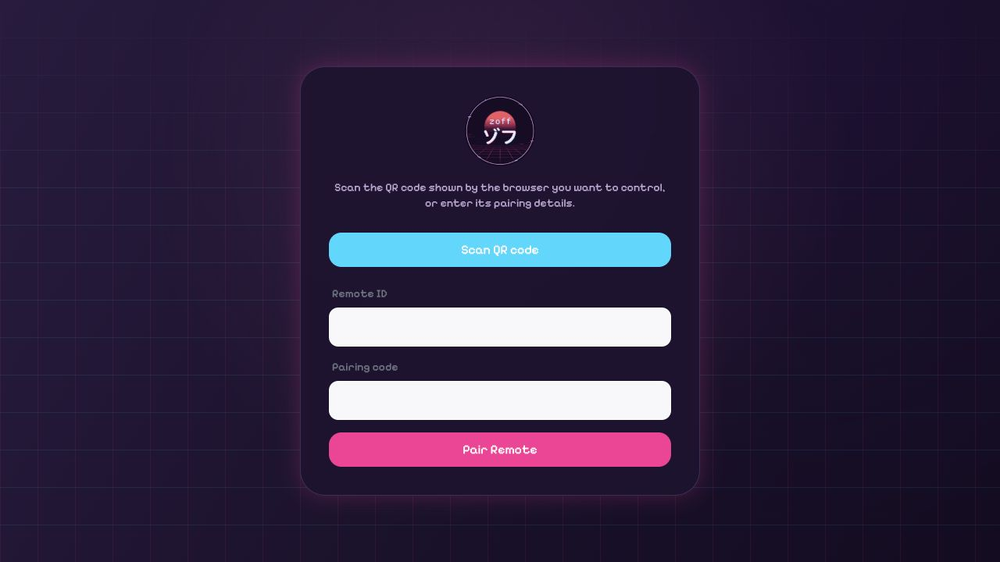

# Zoff Remote

The lightweight web controller for pairing with and operating another Zoff
screen. Visitors can scan the displayed QR code or enter a remote ID and
pairing code manually.

Platform and Remote opt into native same-origin cross-document view transitions.
Their shared header, brand and navigation use matching Tailwind snapshot names;
unrelated page content crossfades. Reduced motion disables the animation.
Separate localhost ports are different origins and cannot share document
snapshots; verify this handoff behind a single-origin local proxy.
Platform's global remote-management action lives at `/resources/remotes`;
the Remote application's `/remotes/...` pages are unchanged.

## Visual preview



## Development

From the repository root:

```sh
pnpm --filter @vibes/remote dev
```

The development server runs at `http://localhost:3007/remotes/join`.

Validate the app with:

```sh
pnpm --filter @vibes/remote lint
pnpm --filter @vibes/remote typecheck
pnpm --filter @vibes/remote build
```

## Loading and compilation

Preact renders app components and shared DOM controls. React Compiler is not
used by the DOM builds. The Latin font
is preloaded in HTML and early response hints, with other supported glyphs
loaded on demand. Safe multi-pass minification and build-time Brotli/gzip
compression reduce transfers without changing the browser target. The shared
server retains content types, encoding negotiation, and immutable asset caching.
