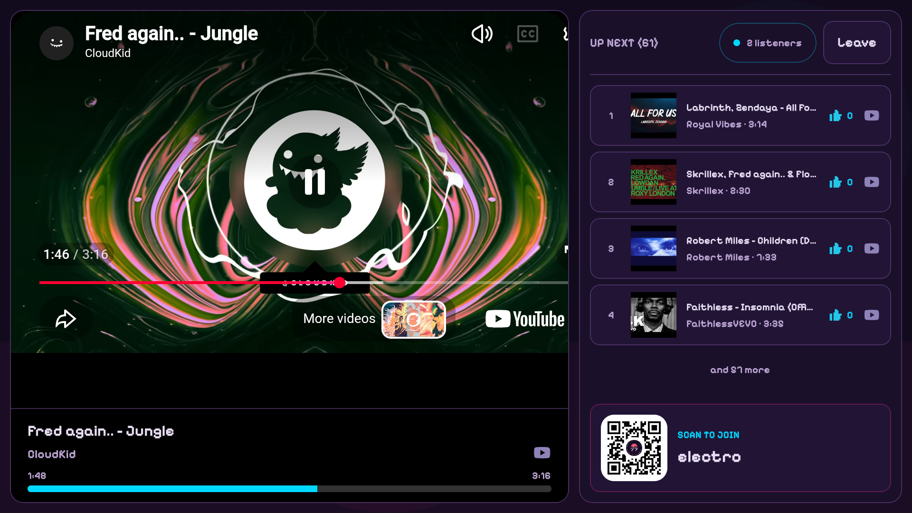

# Zoff TV

Zoff TV is one television application delivered to Android TV and Samsung TVs.
Both builds share the typed room/session hook, `@vibes/api`, `@vibes/models`,
and Zustand room stores. Only the renderer and packaging differ because the two
TV platforms run different application technologies:

- Android TV uses Expo, NativeWind, React Native TV focus handling, and official
  provider WebViews.
- Samsung TV requires a browser-based application package, so that target uses
  Tailwind, spatial remote navigation, and official provider iframes.

## Route data

Android TV uses Expo's registered root component and its existing room/session
state, including directional focus and hardware Back. App hooks call typed
request handlers directly; there is no second router or module registry.
Native request functions live in `src/requests`, separate from `src/screens`;
Android TV has no `src/routes` tree or loader/action modules.
The Samsung Tizen DOM renderer keeps `@kasperrt/smolter/preact` with flat routes
under `src/tizen/routes`.

## Visual preview

### Android TV



The queue is intentionally bounded to five visible rows. Viewers scan the QR
code to add songs and vote from another device rather than manipulating a long
queue with the television remote.

tvOS is intentionally not targeted. Apple TV does not expose a WebView, so it
cannot run YouTube's required official IFrame Player. Extracting direct YouTube
media streams is not a supported or policy-compliant replacement.

## Features

- Music and Watch selection with type-specific public rooms and generation
  prompts. Watch supports YouTube videos; Music retains its music providers.
- Join or create a room by name.
- Generate a new room and playlist from the AI prompt toggle.
- Browse up to six currently active public rooms.
- Search all public rooms and browse twelve results per page.
- Live room, listener, playback, generation, and queue updates over SSE.
- Official YouTube and SoundCloud provider surfaces.
- Cast-style current track, five-song queue, listener count, votes, and a QR
  code linking directly to the room.
- Directional focus and visible focus feedback for television remotes.
- Samsung TV Skip control, including skip votes, room permissions, and request feedback.

Room type is fixed at creation. The backend applies the selected room's provider
and content rules to search, pasted links, imports and generated queues.

## Install and validate

From the repository root:

```sh
pnpm install
pnpm --filter @vibes/tv lint
pnpm --filter @vibes/tv typecheck
pnpm --filter @vibes/tv validate
```

The production API defaults to `https://zoff.me`. Override it for a reachable
local backend:

```sh
EXPO_PUBLIC_API_URL=http://192.168.1.20:8080 pnpm --filter @vibes/tv start
VITE_API_URL=http://192.168.1.20:8080 pnpm --filter @vibes/tv tizen:dev
```

## Android TV

Expo Go does not support television projects. Generate and run a development
build instead:

```sh
pnpm --filter @vibes/tv android:prebuild
EXPO_TV=1 pnpm --filter @vibes/tv android
```

The config plugin marks Leanback as required, disables the touchscreen
requirement, installs the 320×180 TV banner, and registers the Leanback launcher
activity. Use an Android TV emulator or physical Android/Google TV device.

### Expo Application Services

The Expo project is
[`@zoff-music/vibes-tv`](https://expo.dev/accounts/zoff-music/projects/vibes-tv).
Its EAS project ID and Android TV build profiles are committed without any
credentials or account secrets.

Create an installable development build or internal preview APK:

```sh
pnpm --filter @vibes/tv android:build:development
pnpm --filter @vibes/tv android:build:preview
```

Create the Google Play App Bundle only when preparing a release:

```sh
pnpm --filter @vibes/tv android:build:production
```

After the first App Bundle has been uploaded manually and Google Play API
credentials have been configured privately in EAS, submit the latest production
build to the internal track with:

```sh
pnpm --filter @vibes/tv android:submit
```

Never commit a Google service-account key. Samsung Tizen certificates are also
managed outside the repository and are not handled by EAS.

## Samsung TV

Build the self-contained Samsung TV web package:

```sh
pnpm --filter @vibes/tv tizen:build
```

The output is written to `apps/tv/dist/tizen` and includes `config.xml`, the
application icon, bundled MSW98UI font, JavaScript, and CSS. In Tizen
Studio:

1. Import `apps/tv/dist/tizen` as an existing Tizen web project.
2. Select the Samsung TV certificate profile for the target device.
3. Build the signed package and run it on a TV emulator or registered device.

The Tizen target uses `tizen.html` as its configured entry point and requires
the Internet privilege for the Zoff API and provider players.

The package requires Tizen 6.0 or newer. The build targets Chrome 76 and emits classic scripts because the
TV's packaged-file loader supplies no JavaScript MIME type for module scripts.
It also converts newer CSS features, including cascade layers, and bundles
core-js runtime polyfills. Assets retain content hashes. Signing certificates
remain external; the build does not create or publish a signed widget.

The Samsung renderer uses padding gutters and physical sibling margins instead
of CSS `gap`. Plain `:focus` borders and inset shadows show remote focus in yellow;
selected room types and toggles retain cyan borders. These rules do not depend
on flex gap, `:focus-visible`, or modern color functions. Music/Watch links are
included in directional navigation. Skip follows the room's host/admin and skip
settings, displays vote progress when needed, and updates playback through SSE.
The landing screen initially focuses its first room, or Live rooms when empty,
without opening the input keyboard. The smaller white-on-black QR sits in the
bottom-right corner; its logo uses flex centering instead of CSS transforms.

The installed app uses package ID `ZoffMusic0` (Tizen requires ten characters).
YouTube playback loads `https://zoff.me/resources/tv/<id>?video=VIDEO_ID&start=SECONDS`
inside the player area. That script-free page embeds the official YouTube
player, giving it the same `https://zoff.me/` referrer as the web app. Direct
`file:` embeds fail with error 153; a localhost wrapper fixes that error but
still causes some videos to be rejected. The hosted page does not proxy media,
and the TV app needs no local service or application-launch privilege.

The unlisted path is defined once as `TV_PLAYER_PATH` in
`packages/shared/src/tv-player.ts`. It reduces casual discovery; it is not
authentication and is visible in the public source and distributed app.
The existing `/resources/` robots rule excludes the entire prefix without
listing the exact player URL. The old `/tv-player` endpoint is not retained.

**Deploy the platform's unlisted player route before installing this TV build.**
The resource uses a hashed stylesheet, permits framing from `file:` apps, and
sets `Referrer-Policy: strict-origin-when-cross-origin`. Reverse proxies must
preserve those route-specific headers. Other website routes retain their frame
protection. TV builds using localhost or the old `/tv-player` URL must be
updated too; deploying the web route alone does not update a sideloaded app.

For local web testing, run the platform server and set
`VITE_TV_PLAYER_URL=http://localhost:3001/resources/tv/<id>` for `tizen:dev`. This tests
only the wrapper, not YouTube's acceptance of the production domain.

`pnpm --filter @vibes/tv validate` checks classic-script packaging and absence
of a local service. Run the platform build followed by
`pnpm --filter @vibes/platform test:tv-player` and
`pnpm --filter @vibes/serve test:frame-protection` for the hosted resource and
its scoped frame policy. Classic-script startup was verified on Tizen 6;
the hosted-player change still needs validation on the TV after deployment.
Individual videos remain subject to YouTube's embedding and account rules.

## Visual review

Store submission and review screenshots belong in [`docs`](./docs/README.md).
Capture both landing and active-room states at 1920×1080 after verifying focus,
text truncation, QR readability, and official provider controls.
